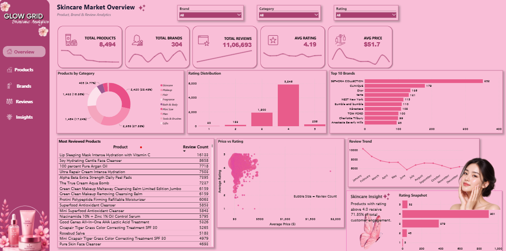
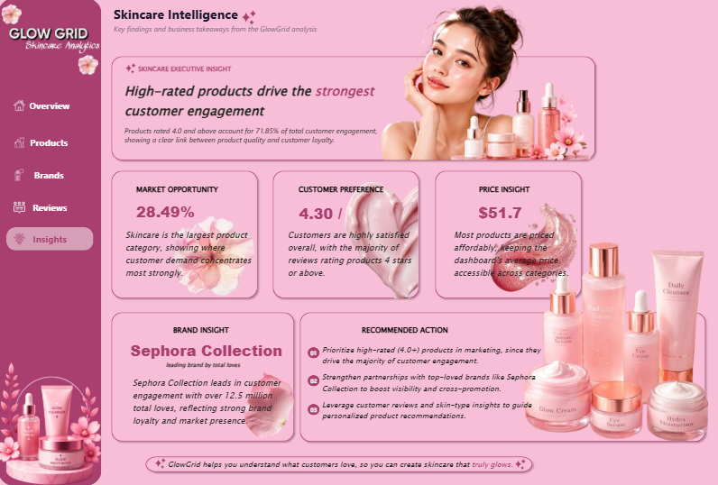

# glowgrid-skincare-dashboard
# GlowGrid — Beauty & Skincare Product Analytics Dashboard

A 5-page Power BI dashboard analyzing Sephora skincare product and review data — built to surface brand performance, pricing, ratings, and customer engagement insights for the beauty industry.

## Preview

## Overview

GlowGrid turns raw Sephora product and review data into a business-analyst-style story: which categories and brands are winning, how price relates to rating, and what drives customer engagement. The entire pipeline — cleaning, modeling, and analysis — was built inside Power BI (Power Query + DAX), with no external SQL step.

## Pages

| Page | What it covers |
|---|---|
| **Overview** | Executive KPIs (Total Products, Brands, Reviews, Avg Rating, Avg Price), Products by Category donut, Rating Distribution, Top 10 Brands, Most Reviewed Products, Price vs Rating bubble chart, Review Trend, Rating Snapshot |
| **Products** | Product-level KPIs, Top Products by Loves, Price Distribution, Rating vs Loves scatter |
| **Brands** | Brand-level KPIs, Top Brands by Loves, Top Brands by Rating (20+ product minimum), Brand Price Positioning |
| **Reviews** | Review Intelligence KPIs (Total Reviews, Avg Review Rating, % Recommended, Helpful Votes), Reviews by Skin Type, Avg Rating by Skin Type, Review Volume Trend |
| **Insights** | Executive insight callouts translating the numbers into business takeaways — market opportunity, customer preference, pricing, brand leadership, and recommended actions |

## Data

- **Source:** [Sephora Products and Skincare Reviews](https://www.kaggle.com/datasets/nadyinky/sephora-products-and-skincare-reviews) (Kaggle)
- **Tables used:** `product_info.csv` (8,494 products, 27 columns) and the combined review files (1.1M+ rows)
- **Relationship:** `product_info` → `Reviews` (1-to-many on `product_id`)

## Key metrics

- 8,494 products across 304 brands
- 11,06,693 customer reviews
- 71.85% of products rated 4.0 or higher
- Skincare is the largest category (28.49% of the catalog)
- Sephora Collection leads all brands by total "loves"

## Tools & techniques

- **Power Query** — data cleaning, type fixes (e.g. `rating` column text→decimal), Review Month custom column, table appends
- **DAX** — measures for attrition-style rates, percentages, and averages (e.g. `Pct Rating 4Plus`, `Avg Review Rating`)
- **Deneb (custom visual)** — Vega-Lite sparklines on KPI cards, styled as a 3-layer glow line
- **Design** — custom pink/lilac beauty-tech theme (background `#FFF7FA`, sidebar `#A83F6F`, primary pink `#E94F87`), built to a full design spec across all 5 pages

## Author

**Sreelakshmi P S**
Data Analyst Portfolio Project

---
*Built entirely in Power BI Desktop as part of a self-taught data analytics portfolio.*
